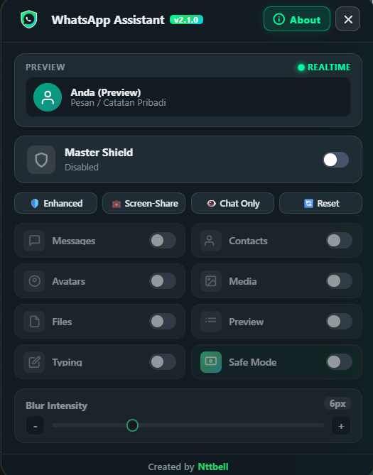
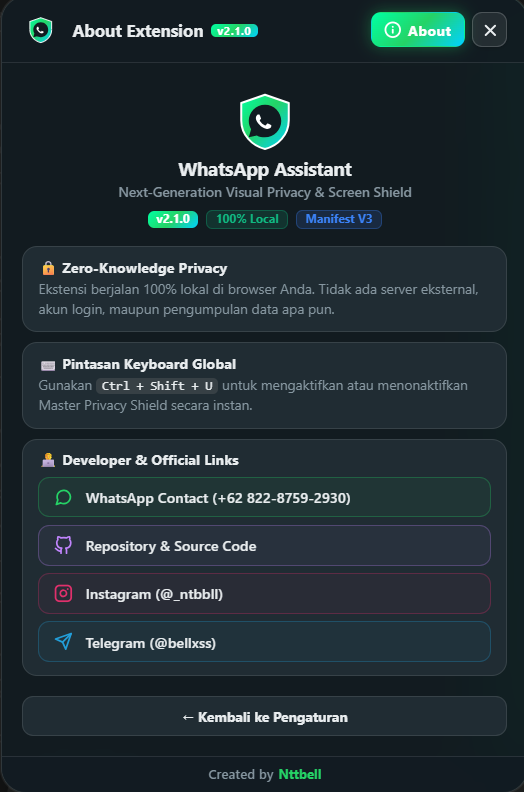
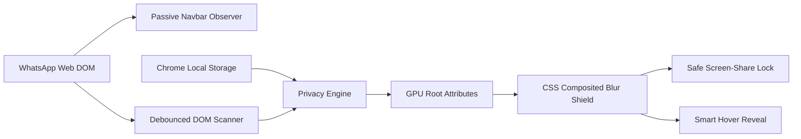

<div align="center">

  

  # 🛡️ WhatsApp Assistant (v2.1.0)
  
  **Next-Generation Visual Privacy & Screen Shield for WhatsApp Web**
  
  *Perlindungan visual privasi percakapan tingkat lanjut — aman dari intipan layar di tempat umum, kantor, kafe, dan presentasi daring.*

  <p>
    <a href="LICENSE">
      
    </a>
    <a href="https://www.typescriptlang.org/">
      
    </a>
    <a href="https://vite.dev/">
      
    </a>
    <a href="https://developer.chrome.com/docs/extensions/mv3/intro/">
      
    </a>
    <a href="#keamanan">
      
    </a>
  </p>

  <p>
    <a href="#preview">📸 Preview</a> &nbsp;•&nbsp;
    <a href="#fitur">✨ Fitur Utama</a> &nbsp;•&nbsp;
    <a href="#v21-changes">🚀 Apa yang Baru di v2.1.0</a> &nbsp;•&nbsp;
    <a href="#arsitektur">🛠️ Arsitektur</a> &nbsp;•&nbsp;
    <a href="#instalasi">📦 Instalasi</a> &nbsp;•&nbsp;
    <a href="#penggunaan">💬 Penggunaan</a> &nbsp;•&nbsp;
    <a href="#keamanan">🔐 Privasi</a> &nbsp;•&nbsp;
    <a href="#lapor-bug">🐛 Lapor Bug</a> &nbsp;•&nbsp;
    <a href="#lisensi">📄 Lisensi</a>
  </p>

</div>

---

<a id="preview"></a>
## 📸 Preview Tampilan

Antarmuka modern, intuitif, dan responsif dari WhatsApp Assistant di WhatsApp Web:

<div align="center">
  <table border="0" width="100%">
    <tr>
      <td align="center" width="50%" valign="top">
        <strong>⚙️ Panel Kontrol Privasi (Dashboard)</strong><br><br>
        
      </td>
      <td align="center" width="50%" valign="top">
        <strong>ℹ️ Informasi & Dukungan (About)</strong><br><br>
        
      </td>
    </tr>
  </table>
</div>

---

<a id="tentang"></a>
## 🌟 Tentang WhatsApp Assistant

**WhatsApp Assistant** (versi 2.1.0) adalah ekstensi browser modern berperforma tinggi yang dirancang khusus untuk melindungi layar WhatsApp Web Anda dari pandangan orang sekitar (*shoulder surfing*). Solusi sempurna saat Anda:

- ☕ Bekerja di kafe atau ruang publik (*co-working space*).
- 🏢 Berada di kantor, ruang rapat, atau kelas kampus.
- 🖥️ Melakukan *screen sharing* saat presentasi daring (*Google Meet, Zoom, Microsoft Teams*).

Dibangun di atas arsitektur **Chrome Manifest V3**, WhatsApp Assistant terintegrasi langsung di bilah navigasi WhatsApp Web dan beroperasi **100% lokal** di peramban Anda tanpa pernah mengirim data ke server mana pun.

---

<a id="v21-changes"></a>
## 🚀 Apa yang Baru di Versi 2.1.0

- ⚡ **Zero-Lag GPU Composited Engine (60 FPS):** Menghapus seluruh pemanggilan `getBoundingClientRect()` saat scrolling. Seluruh blur diproses langsung oleh GPU browser via atribut root CSS murni tanpa menyebabkan lag atau *layout thrashing*.
- 🛡️ **Penataan Ulang Preset Cepat (Quick Presets Bar):**
  - **Enhanced:** Menyalakan semua proteksi privasi kecuali Safe Mode dan Typing (intensitas 8px).
  - **Screen-Share:** Menyalakan seluruh fitur proteksi termasuk Safe Mode dan Typing (intensitas 8px).
  - **Chat Only:** Menyamarkan pesan percakapan, nama kontak, media, berkas, dan pratinjau chat (intensitas 6px).
  - **Reset:** Menonaktifkan seluruh filter privasi dengan mempertahankan Master Switch tetap **ON** (intensitas 6px).
- 🖼️ **Sinkronisasi Panel Info Kontak (Profile Info Drawer):** Menyamarkan foto profil berukuran besar dan seluruh pratinjau kartu pada seksi *"Media, tautan, dan dok"* di panel info kontak.
- 👥 **Proteksi Foto Profil Obrolan Grup & Channel:** Menyamarkan foto profil pengirim di sebelah bubble chat grup, arsip obrolan, dan saluran WhatsApp.
- 🔗 **Sensor Link Preview & Undangan Grup:** Menyamarkan seluruh pratinjau tautan web (Google Drive, YouTube, URL) dan kartu undangan tautan grup.
- 🐛 **Interactive WhatsApp Bug Reporter:** Pengguna dapat melaporkan bug langsung ke WhatsApp Developer (`6282287592930`) dengan pesan otomatis terformat dari dalam panel About.
- 🎨 **Native Tooltip & Hover Experience:** Tooltip bawaan browser yang kaku diganti dengan pill melayang putih bersih khas WhatsApp Web lengkap dengan efek hover melingkar abu-abu.
- 🖱️ **Draggable Floating Drawer:** Panel pengaturan dapat digeser bebas (*drag-and-drop*) ke posisi mana pun di layar dengan pelindung batas layar (*boundary constraint*).

---

<a id="fitur"></a>
## ✨ Fitur Utama

- 🛡️ **Master Privacy Shield** — Saklar utama untuk mengaktifkan atau menonaktifkan seluruh perlindungan dengan sekali klik atau shortcut.
- ⚡ **Zero-Lag GPU Performance** — Performa super mulus tanpa freeze atau penurunan FPS saat scrolling chat panjang.
- 🎯 **Granular Privacy Filters (8 Komponen):**
  - 💬 **Messages:** Menyembunyikan seluruh teks balon percakapan.
  - 👤 **Contact Names:** Menyamarkan nama kontak pribadi maupun grup obrolan.
  - 🖼️ **Profile Pictures:** Mengaburkan foto profil di sidebar, grup, arsip, saluran, dan panel info kontak.
  - 📸 **Media Content:** Memburamkan foto, video, voice note, canvas, dan stiker.
  - 📁 **Files & Documents:** Menyamarkan nama berkas lampiran tanpa merusak tombol menu pesan.
  - 👁️ **Chat List Preview:** Memburamkan baris cuplikan pesan terakhir di daftar chat kiri.
  - ✍️ **Typing (Compose Box):** Melindungi teks yang sedang diketik dari intipan orang di sebelah.
  - 🔒 **Safe Screen-Sharing Mode:** Mengunci efek blur dan menonaktifkan intip hover saat presentasi daring.
- 🎚️ **Adjustable Blur Intensity** — Kendali presisi ketebalan blur melalui slider interaktif dan tombol `[-]` `[+]` (2px – 16px).
- 👁️ **Smart Hover-to-Reveal** — Arahkan kursor (*hover*) pada elemen yang diburamkan untuk membaca sementara (otomatis dinonaktifkan jika Safe Mode aktif).
- 📱 **Live Interactive Shield Simulator** — Menampilkan simulasi langsung blur dengan avatar dan nama akun asli pengguna secara *real-time*.
- ⌨️ **Keyboard Shortcut Global** — Tekan `Ctrl + Shift + U` (atau `Cmd + Shift + U` di Mac) untuk toggle Master Switch instan di mana saja.

---

<a id="arsitektur"></a>
## 🛠️ Arsitektur & Cara Kerja



### 🧰 Spesifikasi Teknologi

| Komponen | Spesifikasi & Penggunaan |
| :--- | :--- |
| **Bahasa Pemrograman** | [TypeScript 5.9](https://www.typescriptlang.org/) — Type-safe, modular, dan terstruktur |
| **Build Tool** | [Vite 7.3](https://vite.dev/) & [esbuild](https://esbuild.github.io/) — Bundle mandiri super ringan dan cepat |
| **Ekstensi Standar** | [Chrome Manifest V3](https://developer.chrome.com/docs/extensions/mv3/intro/) — Service Worker modern, ramah memori |
| **Pintasan Keyboard** | Chrome Commands API & Window Capture Listener (`Ctrl + Shift + U`) |
| **Penyimpanan Lokal** | `chrome.storage.local` — Penyimpanan preferensi offline di browser pengguna |

---

<a id="instalasi"></a>
## 📦 Panduan Instalasi

WhatsApp Assistant dapat dipasang langsung pada Google Chrome, Microsoft Edge, Brave, Opera, atau browser berbasis Chromium lainnya.

### Langkah 1: Clone Repository

```bash
git clone https://github.com/notbell1/whatsapp-assistant.git
cd whatsapp-assistant
```

### Langkah 2: Install Dependensi

```bash
npm install
```

### Langkah 3: Build Ekstensi

```bash
# Validasi tipe data TypeScript
npm run typecheck

# Kompilasi paket ekstensi produksi
npm run build
```

Setelah proses build selesai, folder **`dist`** akan otomatis terisi dengan `manifest.json`, `content.js`, `background.js`, `popup.html`, `popup.js`, stylesheet, dan aset icon.

### Langkah 4: Pasang ke Google Chrome

1. Buka browser **Google Chrome**.
2. Masuk ke halaman extensions:
   ```text
   chrome://extensions/
   ```
3. Aktifkan saklar **Developer mode** di pojok kanan atas.
4. Klik tombol **Load unpacked** di pojok kiri atas.
5. Pilih folder **`dist`** hasil kompilasi proyek.
6. Ekstensi **WhatsApp Assistant** siap digunakan!

---

<a id="penggunaan"></a>
## 💬 Cara Penggunaan

1. Buka [WhatsApp Web](https://web.whatsapp.com/).
2. Temukan dan klik ikon perisai **WhatsApp Assistant** di bilah navigasi kiri.
3. Panel kontrol privasi mengambang akan terbuka:
   - Pilih preset instan: **Enhanced**, **Screen-Share**, **Chat Only**, atau **Reset**.
   - Aktifkan atau nonaktifkan filter tertentu sesuai kenyamanan Anda.
   - Geser slider **Blur Intensity** untuk menyesuaikan ketebalan efek penyamaran.
   - Tarik bagian header panel untuk memindahkan posisi drawer ke tempat yang diinginkan.
4. **Pintasan Cepat:** Tekan `Ctrl + Shift + U` kapan saja untuk menyalakan atau mematikan seluruh perlindungan dalam sekejap.

---

<a id="keamanan"></a>
## 🔐 Komitmen Privasi & Keamanan

- ❌ **Zero External Latency:** Tidak memerlukan server luar, analitik, maupun pelacak data.
- ❌ **Tidak Menyentuh Kredensial:** Ekstensi tidak pernah membaca password, cookie sesi, atau token WhatsApp.
- ❌ **Tidak Menyimpan Pesan:** Percakapan dan kontak Anda tidak pernah direkam atau dikirim keluar browser.
- ✅ **100% Client-Side:** Seluruh manipulasi visual dijalankan murni oleh peramban pengguna menggunakan CSS filter GPU.

---

<a id="lapor-bug"></a>
## 🐛 Hubungi Developer & Lapor Bug

Jika Anda menemukan bug, kendala tampilan, atau memiliki saran fitur:
- 🟢 **WhatsApp:** [wa.me/6282287592930](https://wa.me/6282287592930) *(Tersedia form pesan instan di panel About ekstensi)*
- 🐙 **GitHub Repository:** [notbell1/whatsapp-assistant](https://github.com/notbell1/whatsapp-assistant)
- 📸 **Instagram:** [@\_ntbbll](https://www.instagram.com/_ntbbll)
- ✈️ **Telegram:** [@bellxss](https://t.me/bellxss)

---

<a id="lisensi"></a>
## 📄 Lisensi

Proyek ini dirilis di bawah lisensi resmi **[MIT License](LICENSE)**. Bebas digunakan, dipelajari, dan dimodifikasi untuk kebutuhan personal maupun profesional.

<p align="center">
  <sub>🛡️ WhatsApp Assistant v2.1.0 &bull; code with love - created by <strong><a href="https://www.instagram.com/_ntbbll" style="color:#25D366; text-decoration:none;">Nttbell</a></strong></sub>
</p>
